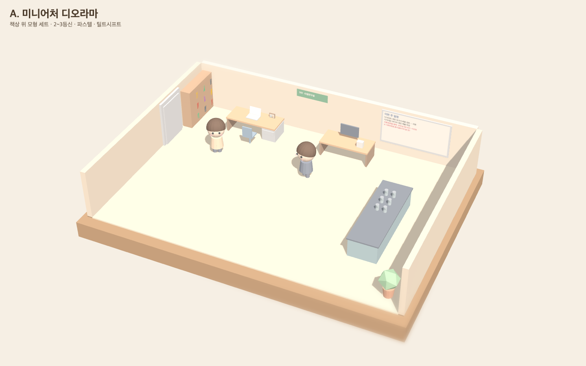
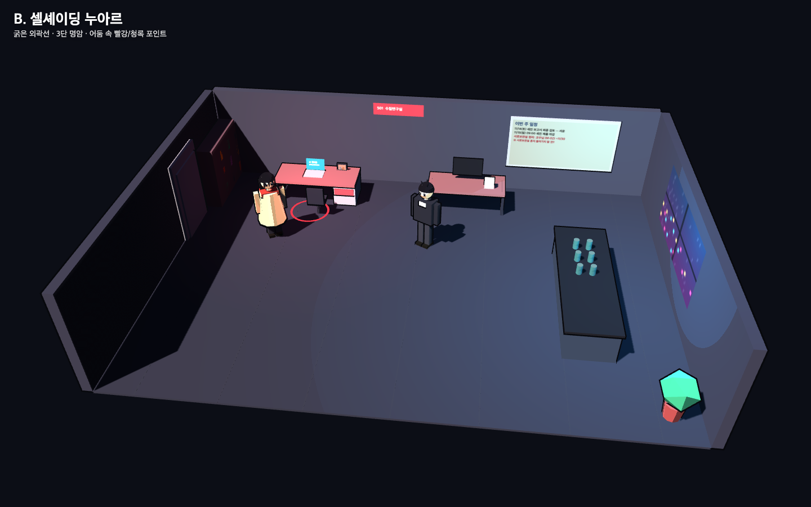
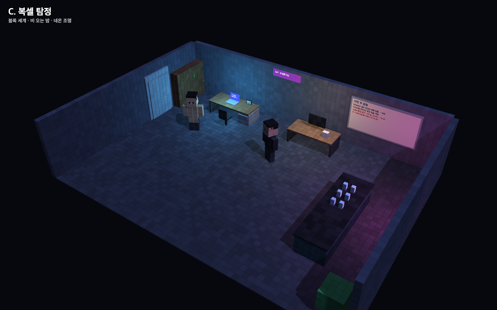

# 「4°C」 비주얼 컨셉 시안

같은 5층 연구실 배치(플레이어, 강태오, 서윤 책상, 화이트보드, 실험대)를 스타일만 바꿔 렌더링했다.
모두 기본 도형으로 만든 **방향성 시안**이다. 실제 제작 시에는 전용 3D 모델과 텍스처로 완성도를 올린다.

## A. 미니어처 디오라마
책상 위 모형 세트 · 2~3등신 · 파스텔 · 틸트시프트

## B. 셀셰이딩 누아르 (추천)
굵은 외곽선 · 3단 명암 · 어둠 속 빨강/청록 포인트 · 단서 사물 붉은 강조

## C. 복셀 탐정
블록 세계 · 비 오는 밤 · 네온 조명

## D. 시네마틱 리얼
실사 캐릭터와 고품질 에셋이 있어야 제대로 보여줄 수 있어 시안에서 제외했다.

---
직접 열어 보기: `preview.html?s=a`, `preview.html?s=b`, `preview.html?s=c`
